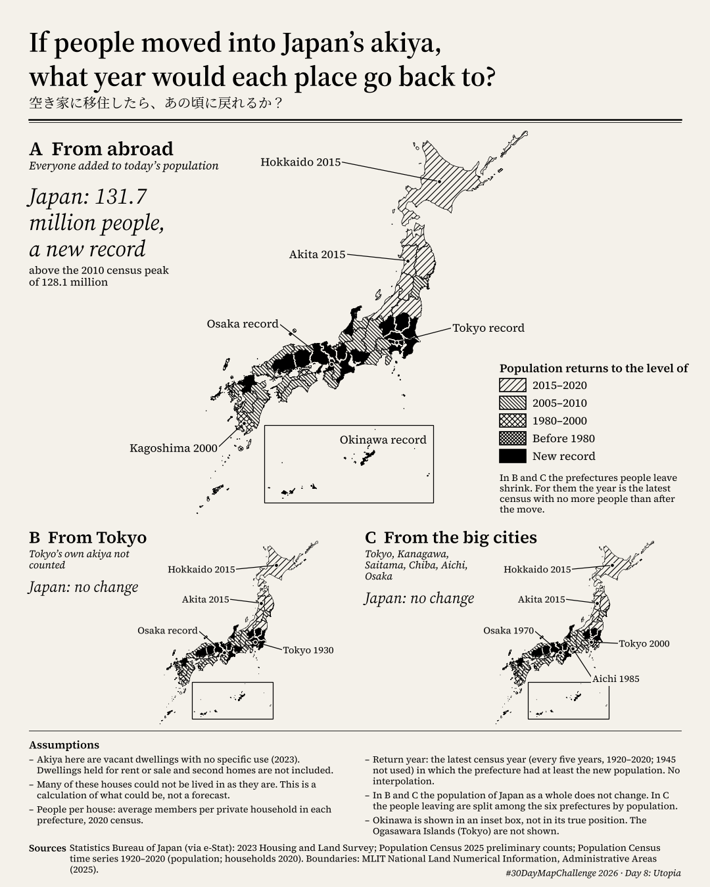
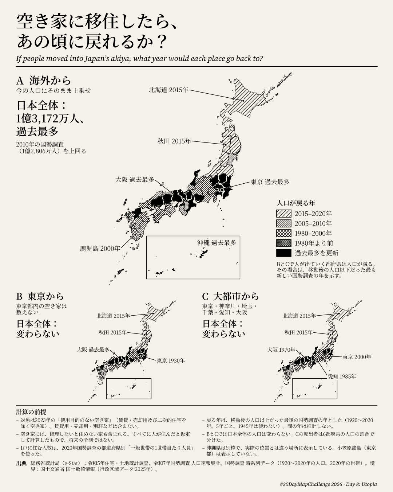

# If people moved into Japan's akiya, what year would each place go back to?

**#30DayMapChallenge 2026 — Day 8: Utopia** ("A map of something which could be.")

空き家に移住したら、街はいつに戻れるか？

| English | 日本語 |
|---|---|
|  |  |

Interactive page: <https://shinyanakashima.github.io/30daymapchallenge-2026day8-akiya/>

On the page you can switch the scenario (A / B / C), change the share of akiya that people move into (0–100%) with a slider, and click or tap a prefecture to see its population from 1920 to 2025 and the year it goes back to. English and Japanese are available (`?lang=ja`). The calculation in the page is the same as in `scripts/compute.py`; at 100% it gives the same results.

## The map

Japan has about 3.86 million vacant dwellings that are not held for rent, for sale or as second homes (2023 Housing and Land Survey). If people moved into all of them, at each prefecture's average household size, 8.67 million people would move in. The map shows, for each prefecture, the census year whose population it would return to, under three cases of where those people come from:

- **A. From abroad** — everyone is added to today's (2025) population.
- **B. From Tokyo** — everyone comes from Tokyo; Japan's total does not change.
- **C. From the big cities** — everyone comes from Tokyo, Kanagawa, Saitama, Chiba, Aichi and Osaka; Japan's total does not change.

### Results

| | Japan | Hokkaido | Akita | Tokyo | Osaka |
|---|---|---|---|---|---|
| A. From abroad | 131.7 million, above every census (peak: 128.1 million in 2010) | 2015 | 2015 | New record | New record |
| B. From Tokyo | No change | 2015 | 2015 | 1930 | New record |
| C. From the big cities | No change | 2015 | 2015 | 2000 | 1970 |

- Even with every akiya filled, most rural prefectures go back only to 2005–2015. Akita and Hokkaido return to their 2015 populations; Kagawa and Kagoshima, the furthest, to 2000.
- In A, 18 prefectures would have more people than at any past census: those around Tokyo, Nagoya and Osaka, plus Ishikawa, Okayama, Hiroshima, Fukuoka and Okinawa. So would Japan as a whole.
- In B, Tokyo would lose 8.26 million people (58% of its population) and fall to 5.99 million, a level it last had in 1930.
- In C, the six big-city prefectures go back to between 1970 (Osaka) and 2000 (Tokyo).

Full results by prefecture: [`data/results.csv`](data/results.csv). National values: [`data/national.csv`](data/national.csv).

## Method

For each prefecture *p*:

```
people moving in  add_p = akiya_p (2023) × persons per private household_p (2020)
```

| Scenario | New population |
|---|---|
| A. From abroad | pop2025_p + add_p for every prefecture. Japan's total increases. |
| B. From Tokyo | pop2025_p + add_p outside Tokyo. Tokyo: pop2025 − (sum of add_p outside Tokyo). Moves into Tokyo's own akiya count as zero. Japan's total is unchanged. |
| C. From the big cities | pop2025_p + add_p outside the six prefectures (Tokyo, Kanagawa, Saitama, Chiba, Aichi, Osaka). Each of the six: pop2025 − (sum of add_p outside the six) × its share of the six prefectures' 2025 population (whole persons, largest-remainder rounding). Japan's total is unchanged. |

**Return year.** Census years 1920, 1925, … 2020 (every five years) are compared with the new population. No interpolation is done, so every result is a census year.

- If the prefecture gains people: the latest census year in which its population was at least the new population. If no census reached it: **New record**.
- If the prefecture loses people (Tokyo in B; the six prefectures in C): the latest census year in which its population was at most the new population. Taken literally, the "at least" rule would always give 2020 for a shrinking prefecture, so the mirror rule is used.
- 1945 is not used (no regular census was taken; the 1945 figures in the time series come from the November 1945 population survey and do not include Okinawa). The 1947 extraordinary census is not used either.
- Japan as a whole: same rule. A gives a new record; B and C give "No change".

**Classes on the map.** Hatching (black lines only): 2015–2020 (sparse, rising to the right), 2005–2010 (denser, rising to the left), 1980–2000 (crossed), before 1980 (dense crossed). Prefectures above every past census are solid black.

### Checks and odd-looking values

- **Tokyo goes back to 1930 in B.** This is the result of the rule, not an error. Tokyo would lose every person who moves into an akiya elsewhere (8,260,242 people), leaving 5,985,977. Tokyo had 5,408,678 people in 1930 and 6,369,919 in 1935; in 1950 it had 6,277,500. The last census with no more than 5.99 million people is therefore 1930. The 1945 survey figure (3,488,284) is excluded.
- **Akita goes back only to 2015** although its 1930 population (987,706) is just below the new population (987,842). The rule takes the latest year whose population was at least the new value (2015: 1,023,119).
- **Okinawa.** The census time series has no Okinawa figure for 1945 (treated as no data). Figures for 1950–1970 are present in the official table. The 1950 figure (914,937) is larger than 1955 (801,065); it appears to include an area that was later counted elsewhere (such as the Amami Islands, returned to Japan in 1953 and included in Kagoshima from 1955). This does not affect any result: Okinawa's new population is above every census figure in all three scenarios.
- **Kagoshima 1950** (1,804,118) excludes the Amami Islands, which were under US administration. Kagoshima's result (2000) does not depend on 1950.
- Prefecture totals were checked against the national totals for akiya (3,856,000) and 2025 population (123,049,524). Prefecture-level figures are used throughout, so municipal mergers do not affect the comparison.
- Persons per household in each prefecture were recomputed from private household members ÷ private households and match the published value.

## Data

All statistics are official tables downloaded from e-Stat on **2026-11-05**. The files are in [`data/raw/`](data/raw/) and the download record is in [`data/raw/sources.json`](data/raw/sources.json).

| Data | Table | Download URL |
|---|---|---|
| Akiya, 2023 | 2023 Housing and Land Survey (令和5年住宅・土地統計調査), basic tabulation on dwellings and households, Table 1-1. Column "賃貸・売却用及び二次的住宅を除く空き家" | https://www.e-stat.go.jp/stat-search/file-download?statInfId=000040209841&fileKind=0 |
| Persons per private household, 2020 | Population Census time series (国勢調査 時系列データ), households, Table 1 part 1, column "一般世帯 1世帯当たり人員" for 2020 | https://www.e-stat.go.jp/stat-search/file-download?statInfId=000001086170&fileKind=0 |
| Population, 2025 | 2025 Population Census, preliminary counts (令和7年国勢調査 人口速報集計), Table 1 | https://www.e-stat.go.jp/stat-search/file-download?statInfId=000040454825&fileKind=0 |
| Population, 1920–2020 | Population Census time series (国勢調査 時系列データ), Table 1: population by sex, Japan and prefectures (1920–2020) | https://www.e-stat.go.jp/stat-search/file-download?statInfId=000001085925&fileKind=0 |
| Prefecture boundaries | MLIT National Land Numerical Information, Administrative Areas (国土数値情報 行政区域データ N03), 2025-01-01, prefecture file. Simplified to [`data/geo/prefectures.geojson`](data/geo/prefectures.geojson) | https://nlftp.mlit.go.jp/ksj/gml/data/N03/N03-2025/N03-20250101_GML.zip |

Source: Statistics Bureau of Japan (総務省統計局), e-Stat. Boundaries: 「国土数値情報（行政区域データ）」（国土交通省）を加工して作成.

Fonts: Source Serif 4 and Noto Serif JP (SIL Open Font License 1.1), from the google/fonts repository.

## Reproduce

Python 3.11 or later.

```sh
pip install -r requirements.txt
python scripts/fetch_data.py         # statistics -> data/raw/
python scripts/build_boundaries.py   # N03 (about 630 MB, cached in .cache/) -> data/geo/prefectures.geojson
python scripts/compute.py            # -> data/inputs.csv, data/results.csv, data/national.csv
python scripts/render.py             # -> output/day8-akiya-en.png, output/day8-akiya-ja.png (1080 x 1350)
cd scripts && python build_web.py    # -> docs/data/akiya.json, docs/data/prefectures.geojson
```

`render.py` downloads the fonts into `.cache/fonts/` on first run. Copy the images into `docs/` to update the web page. The page in `docs/` is deployed to GitHub Pages by `.github/workflows/pages.yml` on every push to `main` that changes `docs/`.

## Alt text

**English**

> A black-and-white map of Japan titled "If people moved into Japan's akiya, what year would each place go back to?". Prefectures are hatched by the census year their population would return to if 3.86 million vacant homes with no specific use were filled at each prefecture's average household size (8.67 million people). Large map, people from abroad: Japan would reach 131.7 million, above every census. Most of Hokkaido, Tohoku, Shikoku and Kyushu go back only to 2000–2015 (Hokkaido 2015, Akita 2015, Kagoshima 2000); 18 prefectures, including Tokyo, Osaka and Okinawa, set new records. Two smaller maps, where Japan's total does not change: people from Tokyo, Tokyo falls to its 1930 level; people from the six big-city prefectures, Osaka goes back to 1970, Aichi to 1985 and Tokyo to 2000. Notes: the count excludes homes for rent or sale and second homes, many akiya are not fit to live in, and this is a "what could be" calculation, not a forecast.

**日本語**

> 「空き家に移住したら、街はいつに戻れるか？」と題した白黒の日本地図。使用目的のない空き家386万戸に都道府県ごとの平均世帯人員で人が住んだ場合（867万人）、各都道府県の人口が何年の国勢調査の水準に戻るかを斜線の種類で示す。大きな地図は海外から来る場合で、日本全体は1億3,172万人と過去最多になる。北海道・東北・四国・九州の多くは2000〜2015年までしか戻らず（北海道2015年、秋田2015年、鹿児島2000年）、東京・大阪・沖縄など18都府県は過去最多を更新する。小さな2枚の地図は日本全体の人口が変わらない場合で、東京から来ると東京は1930年の水準まで減り、大都市6都府県から来ると大阪は1970年、愛知は1985年、東京は2000年に戻る。注記：賃貸用・売却用・別荘などは含まない。空き家にはそのまま住めないものも含まれ、予測ではなく「ありえるかもしれない」仮定の計算である。

## Results by prefecture

| Prefecture | Akiya (2023) | Persons / household (2020) | People moving in | Population 2025 | A | B | C |
|---|---:|---:|---:|---:|---|---|---|
| Hokkaido | 163,000 | 2.04 | 332,246 | 4,985,419 | 2015 | 2015 | 2015 |
| Aomori | 55,000 | 2.34 | 128,587 | 1,140,395 | 2015 | 2015 | 2015 |
| Iwate | 54,100 | 2.39 | 129,412 | 1,125,502 | 2015 | 2015 | 2015 |
| Miyagi | 52,000 | 2.30 | 119,395 | 2,227,240 | 2010 | 2010 | 2010 |
| Akita | 43,900 | 2.41 | 105,742 | 882,100 | 2015 | 2015 | 2015 |
| Yamagata | 35,900 | 2.61 | 93,671 | 993,127 | 2015 | 2015 | 2015 |
| Fukushima | 62,600 | 2.42 | 151,317 | 1,711,937 | 2015 | 2015 | 2015 |
| Ibaraki | 93,200 | 2.37 | 221,087 | 2,791,207 | New record | New record | New record |
| Tochigi | 64,300 | 2.38 | 152,914 | 1,864,833 | New record | New record | New record |
| Gunma | 73,100 | 2.35 | 171,545 | 1,867,582 | New record | New record | New record |
| Saitama | 135,800 | 2.28 | 309,863 | 7,287,169 | New record | New record | 1985 |
| Chiba | 158,500 | 2.23 | 353,127 | 6,258,512 | New record | New record | 1985 |
| Tokyo | 214,200 | 1.92 | 410,765 | 14,246,219 | New record | 1930 | 2000 |
| Kanagawa | 151,000 | 2.15 | 324,941 | 9,193,657 | New record | New record | 1990 |
| Niigata | 77,500 | 2.48 | 192,333 | 2,068,476 | 2015 | 2015 | 2015 |
| Toyama | 39,800 | 2.50 | 99,521 | 985,675 | 2010 | 2010 | 2010 |
| Ishikawa | 40,700 | 2.34 | 95,259 | 1,088,221 | New record | New record | New record |
| Fukui | 28,900 | 2.57 | 74,211 | 729,386 | 2010 | 2010 | 2010 |
| Yamanashi | 37,200 | 2.34 | 86,887 | 779,912 | 2005 | 2005 | 2005 |
| Nagano | 92,300 | 2.41 | 222,254 | 1,954,950 | 2005 | 2005 | 2005 |
| Gifu | 74,400 | 2.49 | 185,013 | 1,891,489 | 2010 | 2010 | 2010 |
| Shizuoka | 104,800 | 2.40 | 251,287 | 3,468,845 | 2010 | 2010 | 2010 |
| Aichi | 156,000 | 2.29 | 357,638 | 7,449,403 | New record | New record | 1985 |
| Mie | 83,100 | 2.33 | 193,744 | 1,694,896 | New record | New record | New record |
| Shiga | 48,500 | 2.44 | 118,257 | 1,392,439 | New record | New record | New record |
| Kyoto | 84,900 | 2.12 | 180,222 | 2,502,747 | New record | New record | New record |
| Osaka | 226,900 | 2.10 | 476,107 | 8,764,578 | New record | New record | 1970 |
| Hyogo | 172,700 | 2.23 | 385,477 | 5,323,825 | New record | New record | New record |
| Nara | 49,500 | 2.38 | 117,672 | 1,269,180 | 2010 | 2010 | 2010 |
| Wakayama | 59,800 | 2.28 | 136,233 | 864,262 | 2010 | 2010 | 2010 |
| Tottori | 25,400 | 2.44 | 62,076 | 523,732 | 2010 | 2010 | 2010 |
| Shimane | 36,300 | 2.40 | 87,247 | 629,460 | 2010 | 2010 | 2010 |
| Okayama | 82,600 | 2.30 | 189,694 | 1,808,664 | New record | New record | New record |
| Hiroshima | 114,700 | 2.20 | 251,836 | 2,683,399 | New record | New record | New record |
| Yamaguchi | 80,500 | 2.17 | 174,369 | 1,264,006 | 2010 | 2010 | 2010 |
| Tokushima | 47,600 | 2.26 | 107,384 | 675,489 | 2010 | 2010 | 2010 |
| Kagawa | 47,900 | 2.27 | 108,626 | 907,725 | 2000 | 2000 | 2000 |
| Ehime | 90,100 | 2.16 | 194,490 | 1,260,088 | 2005 | 2005 | 2005 |
| Kochi | 50,100 | 2.11 | 105,827 | 643,437 | 2010 | 2010 | 2010 |
| Fukuoka | 125,500 | 2.15 | 269,907 | 5,081,879 | New record | New record | New record |
| Saga | 28,300 | 2.51 | 71,084 | 781,214 | 2005 | 2005 | 2005 |
| Nagasaki | 64,900 | 2.27 | 147,016 | 1,232,190 | 2010 | 2010 | 2010 |
| Kumamoto | 65,000 | 2.34 | 152,247 | 1,678,090 | 2005 | 2005 | 2005 |
| Oita | 58,000 | 2.22 | 128,715 | 1,076,875 | 2005 | 2005 | 2005 |
| Miyazaki | 55,000 | 2.20 | 120,911 | 1,018,904 | 2005 | 2005 | 2005 |
| Kagoshima | 122,200 | 2.11 | 257,323 | 1,512,969 | 2000 | 2000 | 2000 |
| Okinawa | 28,100 | 2.33 | 65,528 | 1,468,220 | New record | New record | New record |

## License

Code: MIT (see [LICENSE](LICENSE)). Statistics: Statistics Bureau of Japan (e-Stat), used under the e-Stat terms of use (compatible with CC BY 4.0). Boundaries: MLIT National Land Numerical Information.
